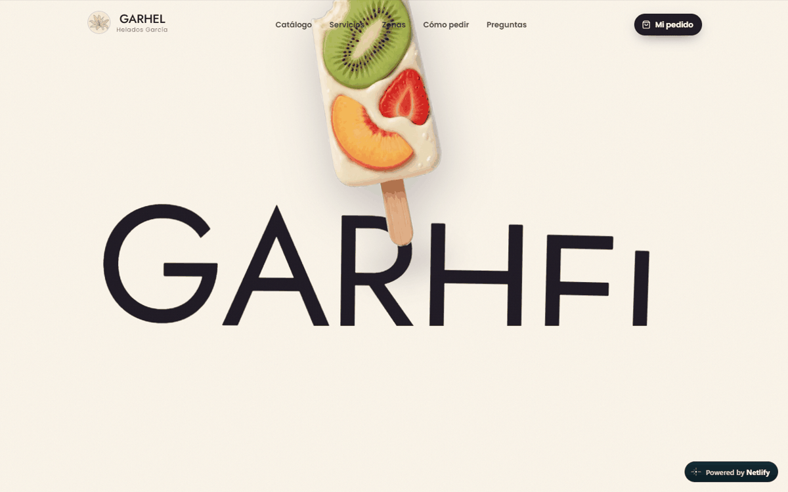
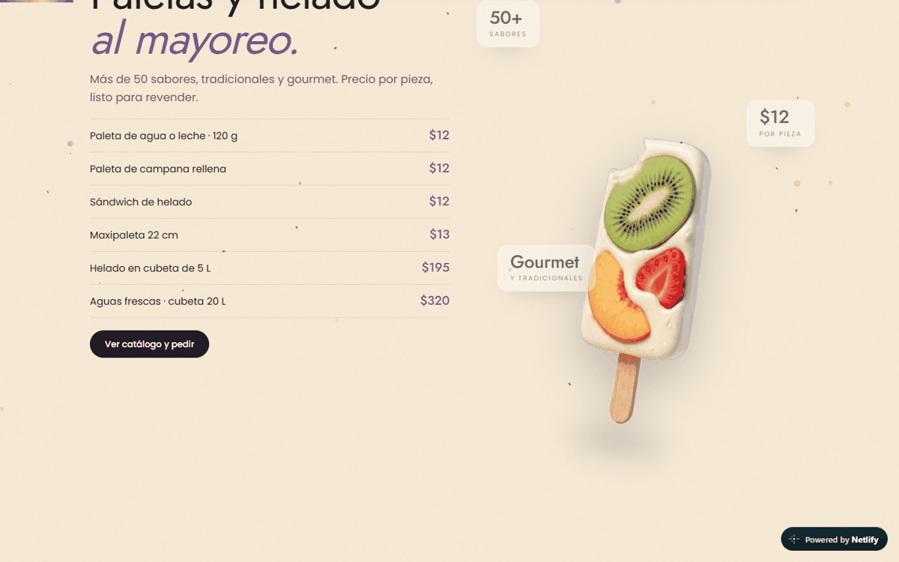

# GARHEL · Helados García — sitio de paletería gourmet

**Demo en vivo:** https://garhel.netlify.app

Sitio para una paletería gourmet y mayorista de Tonalá, Jalisco. Cuenta la marca con animaciones que avanzan con el scroll, y el cliente arma su pedido sabor por sabor y lo confirma por WhatsApp.

> 🔒 El código fuente es privado. Este repositorio es una vitrina del proyecto: qué hace, cómo está hecho y pruebas de que funciona.

## Qué hace
- **Scrollytelling** con GSAP ScrollTrigger: una paleta 3D acompaña todo el recorrido y cambia de posición y giro en cada sección, con tipografía gigante detrás.
- **Catálogo:** 48 sabores de paleta (agua y leche) y 75 de nieve en cubeta, con filtros.
- **Armador de pedido** visual tipo juego, que se envía por WhatsApp.
- **Zonas de entrega** en mapa (Leaflet), con un radio que crece según el volumen del pedido.
- Backend en Supabase: los precios se recalculan en el servidor con una función RPC para que no se puedan manipular.

## Stack
React 19, Vite, TypeScript, Tailwind v4, GSAP, Lenis, Three.js (react-three-fiber), Motion, React Leaflet, Supabase y Netlify.

## Capturas
| Escritorio | Móvil |
|---|---|
|   |  |
